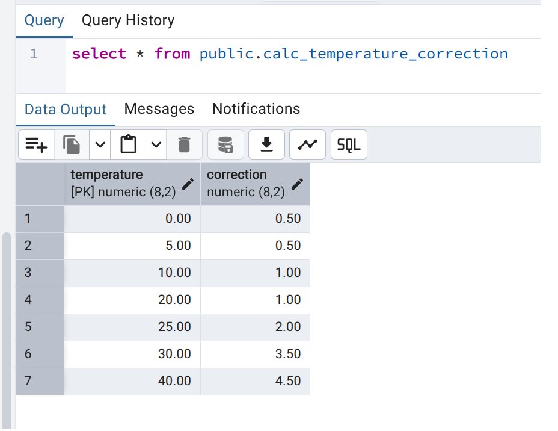

# Привет, бро!

Наш проект продвигается. Мы создали первичный скрипт c информационной базы данных для `PostgreSQL` (с твоей помощью!)
и сумели выполнить его успешно на ресурсах **Заказчика**. Провели успешно демо и подготовили
первичную документацию. Сейчас мы присупаем к непосредственной реализации рассчетной части
и тут снова нужна твоя помощь.

Мы столкнулись с трудностью. Нам нужно реализовать линейную интерполяцию.
Для этого мы создали и загрузили таблицу с корректировками согласно технического задания.

Вот пример:

Необходимо:
- Написать SQL запрос который вернет **4 (четыре значения)** по указанной температре:
  
   * Верхняя граница температура
   * Верхняя граница корректировки
   * Нижняя граница температура
   * Нижняя граница корректировки.

- Например: Для тепература **26 градусов** мы должны получить: `25 - 2` и `30 - 3.5`
- Обязательно должны учитываться граничные условия. Температура выше 40 градусов и температура ниже 0 градусов.
- 4-е полученных параметра необходимо именовать как: `x0 - y0`, `x1 - y1`

Спасибо. 
`Вся надежда лишь на тебя`